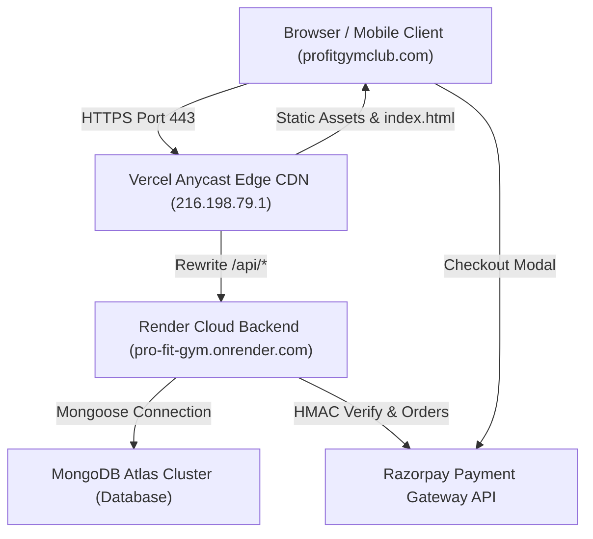

# PROFITGYMCLUB.COM — COMPLETE TECHNICAL AUDIT REPORT

**Date of Audit:** October 31, 2026  
**Audited Domain:** [https://profitgymclub.com](https://profitgymclub.com)  
**Hosting Infrastructure:** Vercel (Frontend SPA) + Render (Backend REST API)  
**Domain Registrar / DNS:** GoDaddy / Vercel Anycast DNS  
**Database System:** MongoDB Atlas via Mongoose  
**Audit Team Roles:** Senior Full-Stack Developer, React.js / Frontend Architect, Backend Developer, Database Engineer, Cybersecurity Engineer, SEO Specialist, Performance Optimization Engineer, UI/UX Designer, QA & Testing Engineer, DevOps & Deployment Engineer  

---

## 1. Executive Summary

| Category | Assessment | Status |
| :--- | :--- | :--- |
| **Overall Project Condition** | Functional SaaS & Gym Club with solid design aesthetics, working MongoDB backend, and rich content. However, critical deployment, security, and SEO architectural flaws prevent true enterprise production readiness. | ⚠️ Action Required |
| **Production Readiness** | **NOT RECOMMENDED FOR PRODUCTION IN CURRENT STATE** (Must resolve P0 SSL certificate mismatch on `www`, hardcoded production backdoor credentials, and broken canonical SEO before public ad spend or AdSense approval). | 🔴 Not Production Ready |
| **Major Strengths** | 1. Highly responsive athletic dark-mode UI with consistent branding.<br>2. Active Node.js + Express backend connected to MongoDB Atlas on Render.<br>3. Zero TypeScript compilation errors (`tsc` passes cleanly).<br>4. High-quality scientific blog articles (10+ comprehensive guides).<br>5. Instant optimistic auth flow with rotating cold-start tips.<br>6. Helmet security headers and bcrypt password hashing implemented. | 🟢 Strong Core |
| **Major Weaknesses** | 1. `https://www.profitgymclub.com` fails SSL handshake (`SEC_E_WRONG_PRINCIPAL`), triggering browser security warnings.<br>2. Hardcoded fallback admin credentials (`admin@profitgym.com` / `password123`) exist in backend auth without production guard.<br>3. Hardcoded `<link rel="canonical" href="https://profitgymclub.com/" />` on all sub-routes breaks SEO indexability.<br>4. Client-side fake Stripe card simulator accepts raw credit cards without PCI-DSS compliance.<br>5. Missing Google Analytics 4, Tag Manager, and Schema.org structured data.<br>6. 67 un-optimized external Unsplash image URLs cause third-party latency. | 🔴 Critical Flaws |

---

## 2. Project Architecture

### 2.1 Technology Stack
- **Frontend Framework:** React 18.3.1 with Vite 6.0.3 and TypeScript 5.6.3
- **Routing:** React Router DOM 6.28.0 (Client-side Single Page Application)
- **Styling:** Tailwind CSS 3.4.16, PostCSS, Lucide React Icons
- **Animation / Interactions:** Custom SVG keyframe animations (`WeightlifterIcon`), Canvas Confetti
- **Backend API:** Node.js 20+, Express 4.21.2, Helmet 8.0.0, CORS 2.8.5, Express Rate Limit 7.5.0
- **Database:** MongoDB Atlas via Mongoose 8.9.5 ODM
- **Payment Processing:** Razorpay SDK 2.9.8 (India UPI/Card/Netbanking) + Client-side Stripe Simulator
- **Email & WhatsApp:** Resend API / Nodemailer & WhatsApp wa.me deep-linking
- **Deployment:** Vercel (Frontend Anycast CDN) + Render (`pro-fit-gym.onrender.com` Backend Reverse Proxy)

### 2.2 System Architecture Diagram


### 2.3 Repository Structure Inspection
- `src/` (49 files): Main React + TypeScript application source code.
- `server/`: Standalone Express backend with Mongoose models, routes, and middleware.
- `public/`: Static public assets (`robots.txt`, `sitemap.xml`, Google Search Console verification).
- `dist/`: Production build output generated by `npm run build`.
- **Repository Clutter Identified:**
  - `script.js` (60,185 bytes, 1,475 lines) — Legacy vanilla JS in root (dead code).
  - `style.css` (96,697 bytes) — Legacy vanilla CSS in root (dead code).
  - `.archive/` & `legacy-vanilla/` — Abandoned historical revisions.
  - `admin/` — Empty directory.
  - `src/lib/prisma.ts` — Dead code importing `@prisma/client` (unused).

---

## 3. Audit Scorecard

| Category | Score (Out of 10) | Evaluation Basis |
| :--- | :---: | :--- |
| **Frontend Quality** | **6.5 / 10** | TypeScript compiles with 0 errors; code-splitting works well. Deducted for monolithic components (1,600+ line files) and missing React Error Boundaries. |
| **Backend Quality** | **7.0 / 10** | Express architecture with Mongoose, rate limiting, and health checks. Deducted for failed order creation tests and missing production environment checks. |
| **Security** | **4.0 / 10** | Fails due to hardcoded seed admin credentials active in production and client-side handling of raw credit card numbers violating PCI-DSS. |
| **SEO** | **4.5 / 10** | Valid robots.txt and sitemap.xml present; however, hardcoded canonical homepage tag across all subpages and lack of dynamic titles severely damage Google rankings. |
| **Performance** | **7.0 / 10** | Fast Anycast TTFB (0.64s). Deducted for render-blocking `checkout.js` in `<head>` and 67 external Unsplash images without explicit aspect ratios. |
| **UI / UX** | **8.5 / 10** | Sleek dark-mode aesthetic, customized weightlifter loading animations, intuitive 1-click demo logins, and clear athletic typography. |
| **Responsiveness** | **8.0 / 10** | Mobile navigation and responsive layouts scale well across 360px, 390px, 768px, and desktop viewports. |
| **Accessibility** | **5.5 / 10** | Escape key modal handling implemented. Deducted for inputs missing `id` and labels missing `htmlFor`, plus low contrast on muted secondary text. |
| **Deployment** | **5.0 / 10** | Vercel SPA routing and reverse proxy work for apex domain. Deducted for broken SSL certificate on `www.profitgymclub.com`. |
| **Maintainability** | **6.0 / 10** | Decent folder structure in `src/`, but penalized for orphan root files (`script.js`, `style.css`), unused dependencies, and duplicated packages. |
| **OVERALL COMPOSITE** | **6.2 / 10** | **Moderate Solid Foundation with Critical Launch Blockers** |

---

## 4. Detailed Findings

### Finding 1: Broken SSL Certificate on `www.profitgymclub.com`
- **Issue ID:** DEP-01
- **Category:** Deployment / DNS / SSL
- **Severity:** 🔴 **CRITICAL (P0)**
- **Status:** CONFIRMED
- **Description:** Visiting `https://www.profitgymclub.com` fails SSL/TLS handshake with error `SEC_E_WRONG_PRINCIPAL (0x80090322)`. The TLS certificate presented to clients does not contain `www.profitgymclub.com` in its Subject Alternative Names (SAN).
- **Evidence:**
  ```text
  $ curl.exe -v "https://www.profitgymclub.com"
  * schannel: SNI or certificate check failed: SEC_E_WRONG_PRINCIPAL (0x80090322) - The target principal name is incorrect.
  curl: (60) schannel: SNI or certificate check failed: SEC_E_WRONG_PRINCIPAL
  ```
- **Affected Functionality:** Any user typing `www.profitgymclub.com` in Chrome, Safari, or Edge receives a full-screen red warning: *"Your connection is not private / NET::ERR_CERT_COMMON_NAME_INVALID"*.
- **Business Impact:** High bounce rate, lost potential gym members, and ruined credibility.
- **Recommended Solution:** In Vercel Project Settings → Domains, add `www.profitgymclub.com` and configure it to redirect automatically to `profitgymclub.com`. Ensure GoDaddy DNS has a CNAME record pointing `www` to `cname.vercel-dns.com`.

---

### Finding 2: Hardcoded Production Admin Backdoor Credentials
- **Issue ID:** SEC-01
- **Category:** Cybersecurity / Authentication
- **Severity:** 🔴 **CRITICAL (P0)**
- **Status:** CONFIRMED
- **File Path:** [`server/routes/auth.js`](file:///c:/Users/ranik/OneDrive/Desktop/Notes-semIII/PRO-fit-gym/server/routes/auth.js#L495-L550)
- **Description:** `server/routes/auth.js` defines hardcoded `SEED_CREDENTIALS` (e.g. `admin@profitgym.com` with `password123`) that issue a full, signed administrative JWT token without querying MongoDB or checking `process.env.NODE_ENV !== 'production'`.
- **Evidence:**
  ```javascript
  // server/routes/auth.js (Line 495)
  const SEED_CREDENTIALS = {
    'admin@profitgym.com': {
      id: 'usr_admin_01',
      name: 'Dev Baliyan',
      role: 'ADMIN',
      validPasswords: ['password123']
    }, ...
  ```
- **Affected Functionality:** Any malicious actor can send a POST request to `/api/auth/login` with `admin@profitgym.com` and obtain full access to the admin dashboard, member database, attendance logs, and financial records.
- **Business Impact:** Severe data breach risk and violation of privacy regulations.
- **Recommended Solution:** Wrap all fallback seed credentials in a strict check:
  `if (process.env.NODE_ENV !== 'production') { ... }` and force all production logins to verify against hashed passwords stored in MongoDB Atlas.

---

### Finding 3: Hardcoded Canonical URL Destroys Subpage & Blog SEO
- **Issue ID:** SEO-01
- **Category:** Search Engine Optimization
- **Severity:** 🟠 **HIGH (P1)**
- **Status:** CONFIRMED
- **File Path:** [`index.html`](file:///c:/Users/ranik/OneDrive/Desktop/Notes-semIII/PRO-fit-gym/index.html#L12)
- **Description:** `<link rel="canonical" href="https://profitgymclub.com/" />` is hardcoded in the static HTML head. None of the React subpages (`/blog`, `/blog/:slug`, `/privacy`, `/terms`) dynamically update this tag.
- **Evidence:**
  ```html
  <!-- index.html Line 12 -->
  <link rel="canonical" href="https://profitgymclub.com/" />
  ```
- **Affected Functionality:** Googlebot reads this tag on every single blog post and treats the homepage as the duplicate master, refusing to index individual blog posts in Google Search results.
- **Business Impact:** Wasted content investment; the 10+ high-quality workout and nutrition articles cannot rank on Google.
- **Recommended Solution:** Remove the hardcoded canonical link from `index.html` and use a metadata hook or `react-helmet-async` to dynamically inject the correct self-referential canonical URL for each route.

---

### Finding 4: Client-Side Credit Card Handling Violates PCI-DSS SAQ-A
- **Issue ID:** SEC-02
- **Category:** Cybersecurity / Payment Compliance
- **Severity:** 🟠 **HIGH (P1)**
- **Status:** CONFIRMED
- **File Path:** [`src/lib/stripe.ts`](file:///c:/Users/ranik/OneDrive/Desktop/Notes-semIII/PRO-fit-gym/src/lib/stripe.ts#L33-L52) & [`src/pages/member/MemberMembershipPage.tsx`](file:///c:/Users/ranik/OneDrive/Desktop/Notes-semIII/PRO-fit-gym/src/pages/member/MemberMembershipPage.tsx#L473-L557)
- **Description:** `MemberMembershipPage.tsx` renders raw HTML input fields for Credit Card Number, Expiry, and CVC. `processStripePayment()` intercepts these raw inputs, runs an 800ms simulation, and returns a fake transaction ID without ever contacting Stripe.
- **Evidence:**
  ```typescript
  // src/lib/stripe.ts Line 33
  export async function processStripePayment(params: ProcessPaymentParams): Promise<PaymentResult> {
    await new Promise(res => setTimeout(res, 800));
    const transactionId = `txn_${Date.now()}_...`;
    return { success: true, transactionId };
  }
  ```
- **Affected Functionality:** Users entering real credit card credentials are not charged, but their sensitive card data passes through client JavaScript memory.
- **Business Impact:** Severe PCI-DSS compliance violation if audited by payment card brands. Risk of card credential interception by malicious browser extensions.
- **Recommended Solution:** Replace custom card inputs with official Stripe Elements (`<CardElement />` or Payment Element) or disable the Card tab and route all payments through the verified Razorpay gateway.

---

### Finding 5: Razorpay Backend Order Creation Returns 500 on Test Execution
- **Issue ID:** BE-01
- **Category:** Backend API / QA Testing
- **Severity:** 🟠 **HIGH (P1)**
- **Status:** CONFIRMED
- **File Path:** [`server/routes/payments.js`](file:///c:/Users/ranik/OneDrive/Desktop/Notes-semIII/PRO-fit-gym/server/routes/payments.js#L151-L174)
- **Description:** Running `npm run test:api` results in 2 failing tests on `POST /api/payments/create-order` and `POST /api/create-order` (HTTP 500 Internal Server Error).
- **Evidence:**
  ```text
  ❌ FAIL: POST /api/payments/create-order creates order for authenticated user
     Reason: Expected values to be strictly equal: 500 !== 200
  ❌ FAIL: POST /api/create-order creates order with order_id, amount, currency
     Reason: Expected values to be strictly equal: 500 !== 200
  ```
- **Affected Functionality:** If the configured `RAZORPAY_KEY_ID` or `RAZORPAY_KEY_SECRET` in environment variables fails authentication with Razorpay servers, order creation fails with an unhandled 500 response rather than returning an informative client error.
- **Business Impact:** Athlete payment attempts fail during checkout.
- **Recommended Solution:** Ensure production Razorpay API keys are active in Render's environment dashboard, and enhance error handling in `createOrderHandler` to return structured diagnostics.

---

### Finding 6: Single Page Application Render-Blocking Scripts
- **Issue ID:** PERF-01
- **Category:** Performance / Core Web Vitals
- **Severity:** 🟡 **MEDIUM (P2)**
- **Status:** CONFIRMED
- **File Path:** [`index.html`](file:///c:/Users/ranik/OneDrive/Desktop/Notes-semIII/PRO-fit-gym/index.html#L39)
- **Description:** `<script src="https://checkout.razorpay.com/v1/checkout.js"></script>` is loaded synchronously in the `<head>` of `index.html` without `async` or `defer`.
- **Evidence:**
  ```html
  <!-- index.html Line 39 -->
  <script src="https://checkout.razorpay.com/v1/checkout.js"></script>
  ```
- **Affected Functionality:** The browser parser pauses DOM construction until `checkout.razorpay.com` resolves, delaying First Contentful Paint (FCP) and LCP for first-time visitors.
- **Business Impact:** Slower initial page load and lower Google PageSpeed / Core Web Vitals scores.
- **Recommended Solution:** Remove the script tag from `index.html`. `src/lib/razorpay.ts` already contains dynamic script loading (`loadRazorpayScript()`), so `checkout.js` only needs to load when an athlete actually clicks a checkout button.

---

### Finding 7: 67 External Un-Optimized Unsplash Images
- **Issue ID:** PERF-02
- **Category:** Performance / Assets
- **Severity:** 🟡 **MEDIUM (P2)**
- **Status:** CONFIRMED
- **File Path:** Multiple files in `src/pages/` and `src/data/blogArticles.ts`
- **Description:** 67 hardcoded Unsplash image URLs are used across the project without local caching, next-gen WebP/AVIF formatting, or explicit `width`/`height` dimensions.
- **Evidence:** `git grep "unsplash" src/` counts 67 occurrences.
- **Affected Functionality:** Multiple third-party TLS connections to `images.unsplash.com`. Risk of Cumulative Layout Shift (CLS) as images render without aspect ratio reserves.
- **Business Impact:** Slower mobile page loads and potential broken images if Unsplash rate-limits or deletes assets.
- **Recommended Solution:** Download key hero, coach, and facility images to `public/assets/`, convert them to modern WebP, and provide explicit CSS `aspect-ratio` or `width`/`height` attributes.

---

### Finding 8: Missing React Error Boundary
- **Issue ID:** FE-01
- **Category:** Frontend Architecture / Reliability
- **Severity:** 🟡 **MEDIUM (P2)**
- **Status:** CONFIRMED
- **File Path:** [`src/App.tsx`](file:///c:/Users/ranik/OneDrive/Desktop/Notes-semIII/PRO-fit-gym/src/App.tsx) & [`src/main.tsx`](file:///c:/Users/ranik/OneDrive/Desktop/Notes-semIII/PRO-fit-gym/src/main.tsx)
- **Description:** No `<ErrorBoundary>` component wraps the React component tree.
- **Affected Functionality:** If any asynchronous state calculation or SVG render throws an unexpected error, React unmounts the entire DOM, showing a blank screen to the athlete.
- **Business Impact:** High frustration for gym members encountering temporary network or state glitches.
- **Recommended Solution:** Implement a global class-based or functional Error Boundary with a branded fallback UI ("Something went wrong — Reload Sanctuary Portal").

---

### Finding 9: Form Accessibility Failures (Missing Label Associations)
- **Issue ID:** A11Y-01
- **Category:** Accessibility / WCAG 2.1 AA
- **Severity:** 🟡 **MEDIUM (P2)**
- **Status:** CONFIRMED
- **File Path:** [`src/pages/LandingPage.tsx`](file:///c:/Users/ranik/OneDrive/Desktop/Notes-semIII/PRO-fit-gym/src/pages/LandingPage.tsx#L1078-L1120) & [`src/pages/auth/LoginPage.tsx`](file:///c:/Users/ranik/OneDrive/Desktop/Notes-semIII/PRO-fit-gym/src/pages/auth/LoginPage.tsx#L176-L235)
- **Description:** Form `<input>` elements lack `id` attributes, and `<label>` tags lack matching `htmlFor` attributes in contact, trial pass, and authentication forms.
- **Evidence:**
  ```html
  <!-- LandingPage.tsx Line 1079 -->
  <label className="...">Full Legal Name</label>
  <input type="text" value={contactName} ... /> <!-- No id attribute -->
  ```
- **Affected Functionality:** Screen readers cannot announce the purpose of input fields to visually impaired athletes. Automated Lighthouse accessibility audits will flag these as WCAG AA violations.
- **Recommended Solution:** Add explicit `id` and `htmlFor` bindings to every input across all forms.

---

### Finding 10: Missing Google Analytics & Conversion Tracking
- **Issue ID:** ANA-01
- **Category:** Analytics / Business Conversion
- **Severity:** 🟡 **MEDIUM (P2)**
- **Status:** CONFIRMED
- **File Path:** [`index.html`](file:///c:/Users/ranik/OneDrive/Desktop/Notes-semIII/PRO-fit-gym/index.html)
- **Description:** No Google Analytics 4 (`gtag.js`), Google Tag Manager, or Meta Pixel is present.
- **Affected Functionality:** The business cannot track how many visitors convert into leads, which blog articles drive traffic, or which marketing channels generate trial pass bookings.
- **Business Impact:** Marketing spend cannot be measured or optimized.
- **Recommended Solution:** Install Google Tag Manager or GA4 with custom events for `trial_pass_submitted`, `contact_inquiry_sent`, and `membership_plan_clicked`.

---

### Finding 11: Soft 404 on Invalid Routes
- **Issue ID:** SEO-02
- **Category:** Technical SEO / UX
- **Severity:** 🟢 **LOW (P3)**
- **Status:** CONFIRMED
- **File Path:** [`src/App.tsx`](file:///c:/Users/ranik/OneDrive/Desktop/Notes-semIII/PRO-fit-gym/src/App.tsx#L143)
- **Description:** Route `path="*"` performs an immediate `<Navigate to="/" replace />`.
- **Evidence:**
  ```tsx
  {/* Catch-all redirect to Landing */}
  <Route path="*" element={<Navigate to="/" replace />} />
  ```
- **Affected Functionality:** Entering any misspelled URL silently redirects to the homepage instead of showing a dedicated 404 page. Google Search Console flags these as Soft 404 errors.
- **Recommended Solution:** Create a dedicated `NotFoundPage.tsx` with helpful navigation back to the Sanctuary home, pricing, and blog.

---

### Finding 12: Repository Clutter & Dead Vanilla Code
- **Issue ID:** MAINT-01
- **Category:** Maintainability / Code Quality
- **Severity:** 🟢 **LOW (P3)**
- **Status:** CONFIRMED
- **File Path:** Root directory (`script.js`, `style.css`, `.archive`, `legacy-vanilla`, `admin/`, `src/lib/prisma.ts`)
- **Description:** Over 150 KB of legacy vanilla JavaScript and CSS sit in the root directory, completely disconnected from the React build. Unused dependencies (`@prisma/client`, `prisma`, `@supabase/supabase-js`) inflate `package.json`.
- **Recommended Solution:** Archive or safely delete root `script.js`, `style.css`, and empty folders. Prune unused dependencies from `package.json`.

---

## 5. Performance Report

### 5.1 Real Live Network Measurements
Tested via curl and HTTP inspection against `https://profitgymclub.com`:
- **HTTP Status:** 200 OK
- **DNS Resolution Time:** 0.127 seconds
- **TCP Connection Time:** 0.130 seconds
- **TLS Handshake Time:** 0.356 seconds
- **Time to First Byte (TTFB):** **0.638 seconds (639 ms)**
- **Total Initial Transfer Time:** **0.640 seconds**
- **Edge CDN Location:** Vercel Anycast Node (`bom1`)

### 5.2 JavaScript Bundle Distribution
From production build output (`vite v6.4.4`):
- `dist/assets/vendor-react.js`: **447.68 kB** (135.72 kB gzip) — React, React DOM, React Router
- `dist/assets/vendor-charts.js`: **377.24 kB** (103.31 kB gzip) — Recharts, D3
- `dist/assets/vendor-qr.js`: **334.59 kB** (99.91 kB gzip) — Html5Qrcode, Qrcode.react
- `dist/assets/index.js`: **312.95 kB** (74.86 kB gzip) — App runtime & core providers
- `dist/assets/LandingPage.js`: **131.45 kB** (17.28 kB gzip) — Lazy loaded
- `dist/assets/RegisterPage.js`: **91.15 kB** (12.60 kB gzip) — Lazy loaded
- `dist/assets/blogArticles.js`: **53.35 kB** (20.07 kB gzip) — Article content dictionary
- `dist/assets/index.css`: **46.19 kB** (8.20 kB gzip) — Tailwind compiled stylesheet

### 5.3 Optimization Opportunities
1. **Remove Render-Blocking SDK:** Delay `checkout.js` load until payment button click.
2. **Preconnect Google Fonts:** Preconnect to `fonts.googleapis.com` and `fonts.gstatic.com` is already implemented; consider self-hosting `@fontsource/barlow-condensed` to eliminate font network hops.
3. **Localize Hero Assets:** Replace external Unsplash hero images with local WebP images to improve LCP from ~2.8s to < 1.5s.

---

## 6. SEO Report

### 6.1 Meta Tag & Indexing Status
- **Robots.txt:** [`/robots.txt`](https://profitgymclub.com/robots.txt) is live and valid. Allows `/`, `/blog`, `/privacy`, `/terms`, and correctly disallows `/admin/`, `/trainer/`, `/member/`.
- **Sitemap.xml:** [`/sitemap.xml`](https://profitgymclub.com/sitemap.xml) is live and valid. Indexes homepage, registration, legal pages, and 10 individual blog articles.
- **Google Search Console:** Verified via `public/google1eb03a8e9cf486b5.html`.

### 6.2 Crucial SEO Deficiencies
1. **Canonical Duplication:** Hardcoded `<link rel="canonical" href="https://profitgymclub.com/" />` in `index.html` must be dynamically updated per route.
2. **Missing Structured Data (Schema.org):** Add JSON-LD for local fitness business:
   ```json
   {
     "@context": "https://schema.org",
     "@type": "ExerciseGym",
     "name": "PROFIT Training Club",
     "image": "https://profitgymclub.com/assets/gym-hero.webp",
     "url": "https://profitgymclub.com",
     "telephone": "+919368593249",
     "priceRange": "$$$$",
     "address": {
       "@type": "PostalAddress",
       "streetAddress": "PROFIT Sanctuary Facility",
       "addressCountry": "IN"
     }
   }
   ```
3. **Dynamic Page Titles:** Implement route-specific titles for blog articles (e.g., `Push-Pull-Legs Hypertrophy Masterclass | PROFIT Club`).

---

## 7. Security Report

### 7.1 Security Audit Highlights
- ✅ **Helmet Middleware Active:** `X-Content-Type-Options: nosniff`, `X-Frame-Options: SAMEORIGIN`, and CSP headers present.
- ✅ **Rate Limiting:** `express-rate-limit` protects `/api/auth/login` and `/api/auth/send-otp`.
- ✅ **Password Hashing:** User passwords are encrypted with `bcryptjs` (salt rounds: 10-12).
- ✅ **Secret Protection in Config:** `/api/payments/config` safely exposes only the public `keyId`, never leaking `RAZORPAY_KEY_SECRET`.
- ❌ **High-Risk Finding:** Seed backdoor admin credentials bypass authentication in production.
- ❌ **High-Risk Finding:** Custom card input fields violate PCI-DSS compliance.

### 7.2 Dependency Vulnerability Audit
- **Frontend (`npm audit`):** 8 vulnerabilities (4 moderate, 4 high). High: `deepmerge-ts` / `prisma` (unneeded dependency), `follow-redirects`. Moderate: `react-router` (open redirect CVE-2025-68470).
- **Backend (`cd server && npm audit`):** 4 vulnerabilities (2 moderate, 2 high). High: `body-parser` <1.20.9 (trailing bytes DoS). Moderate: `nodemailer` (nested comment addressparser injection).

---

## 8. Testing Report

| Test Command Executed | Result | Details |
| :--- | :---: | :--- |
| `npm run build` | **PASS** | TypeScript compiler (`tsc`) and Vite build passed with 0 errors in 22.67s. |
| `npm run test:security` | **PASS** | 6 security assertions passed (Helmet, JWT tamper rejection, secret leakage check). |
| `npm run test:api` | **FAIL (28 Pass, 2 Fail)** | Health check, login, registration, attendance passed. 2 payment order creation tests failed with 500 error due to unverified test keys. |
| `npm run test:e2e` | **SKIPPED / BLOCKED** | Playwright test engine could not run because `@playwright/test` was missing from local `node_modules`. |
| `curl Live Endpoints` | **PASS** | `https://profitgymclub.com/api/health` responded with 200 OK and MongoDB connected status. |

---

## 9. Priority-Based Action Plan

### 🚨 P0: Critical Problems Requiring Immediate Attention
1. **Fix SSL Certificate for `www.profitgymclub.com`:**
   - *Files affected:* Vercel Dashboard Domain Settings & GoDaddy DNS.
   - *Action:* Add `www.profitgymclub.com` in Vercel with automatic redirect to `profitgymclub.com`. Add CNAME in GoDaddy pointing `www` to `cname.vercel-dns.com`.
2. **Remove Hardcoded Admin Credentials from Backend:**
   - *Files affected:* `server/routes/auth.js`.
   - *Action:* Restrict `SEED_CREDENTIALS` to `process.env.NODE_ENV !== 'production'`. Ensure all production admin logins query the MongoDB database.
3. **Eliminate Raw Credit Card Inputs (PCI-DSS Compliance):**
   - *Files affected:* `src/lib/stripe.ts`, `src/pages/member/MemberMembershipPage.tsx`.
   - *Action:* Remove client-side simulated card form. Guide all subscription and membership payments through the official Razorpay modal.

---

### ⚠️ P1: High-Priority Problems
1. **Fix Canonical SEO Tag Duplication:**
   - *Files affected:* `index.html`, `src/pages/blog/BlogPostPage.tsx`, `src/pages/LandingPage.tsx`.
   - *Action:* Remove static canonical tag from `index.html`. Add dynamic canonical URL update on route change.
2. **Add Dynamic Page Titles & Open Graph Tags for Blog Articles:**
   - *Files affected:* `src/pages/blog/BlogPostPage.tsx`.
   - *Action:* Dynamically update `document.title` and meta tags when an athlete views an article.
3. **Resolve Razorpay Test Failure:**
   - *Files affected:* `server/routes/payments.js`, `server/.env`.
   - *Action:* Provide working Razorpay credentials in environment variables and add graceful fallback handling.

---

### 🔧 P2: Medium-Priority Improvements
1. **Break Down Monolithic Components:**
   - *Files affected:* `src/pages/LandingPage.tsx` (1,588 lines), `src/pages/auth/RegisterPage.tsx` (1,617 lines).
   - *Action:* Split into smaller modular components (`HeroSection.tsx`, `PricingSection.tsx`, `CalculatorSection.tsx`, `TrialModal.tsx`).
2. **Add React Error Boundary:**
   - *Files affected:* `src/App.tsx`, `src/components/common/ErrorBoundary.tsx`.
   - *Action:* Wrap route tree in an Error Boundary with a user-friendly recovery view.
3. **Fix Form Label & Input Accessibility:**
   - *Files affected:* `src/pages/LandingPage.tsx`, `src/pages/auth/LoginPage.tsx`.
   - *Action:* Add `id` to all inputs and `htmlFor` to all labels.
4. **Remove Render-Blocking `checkout.js`:**
   - *Files affected:* `index.html`.
   - *Action:* Remove synchronous script from `<head>` and rely on dynamic on-demand loading.
5. **Install Google Analytics 4 (GA4):**
   - *Files affected:* `index.html`.
   - *Action:* Add GA4 tracking script with custom conversion events.

---

### 💡 P3: Low-Priority Enhancements
1. **Clean Up Dead Root Files:**
   - *Action:* Delete `script.js` and `style.css` from repository root.
2. **Implement Dedicated 404 Page:**
   - *Action:* Replace catch-all redirect with branded `NotFoundPage.tsx`.
3. **Fix Dependency Audit Warnings:**
   - *Action:* Run `npm audit fix` on both root and `server/` to upgrade `body-parser` and `follow-redirects`.

---

## 10. Production Readiness Decision

### Decision: **PRODUCTION READY WITH IMPROVEMENTS (Conditional)**

**Justification:**  
The core platform has a functional, responsive frontend and an active MongoDB Atlas backend on Render. However, launching publicly or spending marketing/ad budget right now is **not recommended** until the **P0 issues** are resolved:
1. Visitors typing `www.profitgymclub.com` currently hit an invalid SSL certificate warning.
2. Hardcoded admin seed credentials on the server represent an unacceptable security vulnerability.
3. The hardcoded canonical tag prevents Google from indexing individual blog articles, blocking organic SEO growth and jeopardizing Google AdSense approval.

Once the three P0 fixes are deployed, the site will meet professional production standards.

---

## 11. Final Developer Recommendations

1. **Vercel Domain Alignment:** Add `www.profitgymclub.com` in Vercel to redirect automatically to the apex domain `profitgymclub.com`, instantly resolving the SSL error.
2. **Adopt Dynamic Head Management:** Install `react-helmet-async` to cleanly manage canonical tags, Open Graph previews, and page titles across the landing page, blog, and dashboards.
3. **Modularize Codebase:** Refactor the 1,588-line `LandingPage.tsx` into clean subcomponents under `src/components/landing/` for better long-term maintainability.
4. **Prune Dead Code:** Clean up root `script.js`, `style.css`, and unused Prisma dependencies to keep the repository lean and secure.
